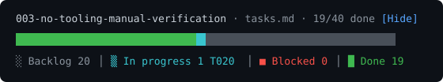

# Implementation progress (micro-kanban)

A Claude Code mod that shows a mini kanban board above the prompt while
`/speckit-implement` runs. It reads `tasks.md` of the current Spec Kit feature and draws
a bar of block glyphs sized in proportion to the tasks in each column, with the counts as
a legend.



| Column | Glyph | Colour | Taken from |
|--------|-------|--------|------------|
| Backlog | `░` | grey | an unchecked task with no marker |
| In progress | `▒` | cyan | `[~]` or `[IN PROGRESS]`, else the task a tool call names (shown as inferred) |
| Blocked | `■` | red | `[BLOCKED…]`, `[NEEDS DECISION]` or `BLOCKED:` on an open task |
| Done | `█` | green | `[X]` |

The glyph density ranks the columns, so the bar reads without colour. The board appears
once a prompt runs a `speckit-implement` command, and redraws when `tasks.md` changes.

## Install

At the prompt of a terminal session:

```text
/plugin install micro-kanban --marketplace leejsinclair/speckit-mod-micro-kanban
```

From a shell:

```bash
claude plugin install micro-kanban --marketplace leejsinclair/speckit-mod-micro-kanban
```

Answer `y` to add the marketplace and pick a scope. In the desktop app, where `/plugin`
does not run: click + next to the prompt box, then Plugins, Add marketplace, and enter
`leejsinclair/speckit-mod-micro-kanban`.

## Use

- The feature is read from `.specify/feature.json`, else from the branch name
  (`NNN-name`, with `specs/<branch>/tasks.md`).
- `/kanban T001` or `/kanban FR-001` prints the lines that mention that id in the
  feature's `tasks.md`, `spec.md`, `plan.md`, `data-model.md` and `research.md`.
- `/kanban off` and `/kanban on` hide and show the board; the Hide button does the same.

## Develop

```bash
claude plugin validate .
claude plugin test .
claude --plugin-dir .      # load it for one session
```

## Licence

MIT.
